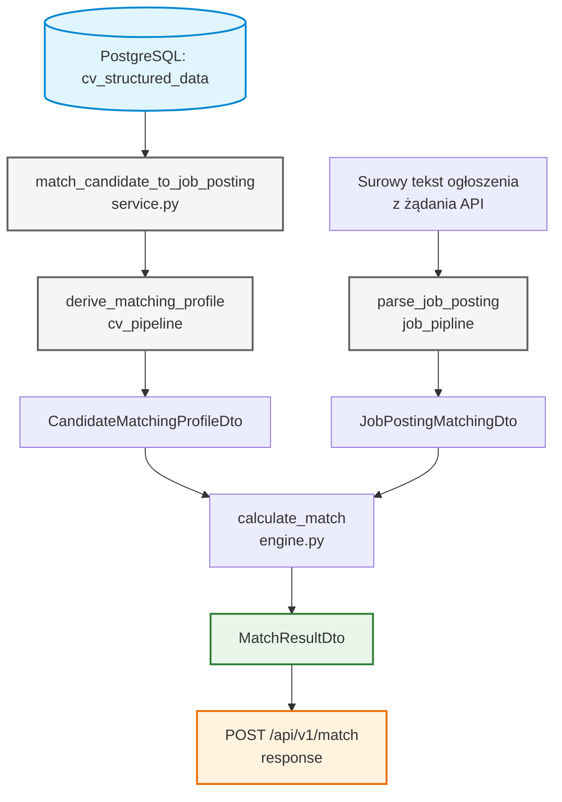

# Moduł Matching Engine

Silnik matchingu liczy wynik dopasowania kandydata (CV) do ogłoszenia o pracę. Jest **osobnym serwisem**, nie częścią `cv_pipeline` ani `job_pipline` — konsumuje tylko dwa znormalizowane DTO (`CandidateMatchingProfileDto`, `JobPostingMatchingDto`) i nic nie wie o tym, jak powstały (OCR, segmentacja sekcji, słowniki tech stacku). Działa **bez LLM** — wyłącznie regex/słowniki/cosine similarity na małych wektorach cech, dzięki czemu jest deterministyczny, szybki i nie wymaga przetwarzania w tle.

Pełna historia decyzji projektowych (dlaczego cosine similarity, dlaczego brak persystencji wyniku) jest w `docs/architecture/matching-engine-roadmap.md` i `docs/architecture/matching-scoring.md`.

---

## Data flow

Wynik **nie jest zapisywany do bazy** — liczony on-demand przy każdym żądaniu (decyzja z Fazy 3 roadmapy).

---

## Główne komponenty

### 1. Silnik scoringu (`engine.py`)

`app.services.matching_engine.engine`
::: app.services.matching_engine.engine

Czysta funkcja `calculate_match(candidate, job_posting) -> MatchResultDto`, bez żadnych zależności od bazy danych czy sieci.

- **Pokrycie skilli (`_skill_cosine_similarity`):** wspólny wektor cech (`candidate_skill_names` jako 1.0/0.0, wymagania oferty jako ich `weight` z `RequiredSkillDto`) porównywany `cosine_similarity` ze scikit-learn. Brak wymaganych skilli w ofercie = pokrycie 1.0 (nie ma czego nie pokryć).
- **Seniority (`_seniority_match`):** skala porządkowa (`junior < mid < senior`), **nie** wchodzi do wektora cosine — osobny modyfikator binarny (`candidate_level >= min_level`), waga 0.25 w `overall_score`.
- **Edukacja (`_education_match`):** osobny binarny bonus (przecięcie `education_category` kandydata z `education_requirement` oferty), waga 0.15. Brak wymogu edukacyjnego w ofercie = zawsze `True`.
- **Domeny i soft skille:** liczone jako przecięcia zbiorów (`domain_overlap`, `soft_skill_overlap`) i zwracane w wyniku jako informacja pomocnicza, ale **nie wchodzą do `overall_score`** (decyzja: `domain_tags` po stronie kandydata jest dziś zawsze puste, brak słownika domen dla CV).
- **`overall_score`:** `100 * (0.6 * skill_coverage + 0.25 * seniority_match + 0.15 * education_match)`.

---

### 2. Warstwa serwisowa (`service.py`)

`app.services.matching_engine.service`
::: app.services.matching_engine.service

Funkcja `match_candidate_to_job_posting(session, *, cv_document_id, job_posting_raw_text) -> MatchResultDto` łącząca dwa pipeline'y z silnikiem scoringu:

1. Pobiera `CVStructuredData` dla `cv_document_id` z bazy (`CVRepository.get_structured_by_lake_id`).
2. Waliduje, że Etap B CV jest zakończony (`status == "completed"`) — w przeciwnym razie zgłasza `CVNotFoundError` albo `CVProcessingNotCompleteError`, mapowane w API na `404`/`409`.
3. Odtwarza `CandidateMatchingProfileDto` przez `derive_matching_profile` (z `cv_pipeline`).
4. Parsuje surowy tekst ogłoszenia **on-the-fly** przez `parse_job_posting` (z `job_pipline`) — bez wcześniejszego `POST /job-postings`.
5. Woła `calculate_match` i zwraca wynik.

---

### 3. API (`routes/matching.py`)

`app.api.v1.routes.matching`
::: app.api.v1.routes.matching

`POST /api/v1/match` — synchroniczny endpoint (bez `BackgroundTasks`, w przeciwieństwie do Etapu B CV, gdzie przetwarzanie LLM wymagało tła; tu nie ma LLM po żadnej stronie).

**Wejście** (`MatchRequestDto`): `cv_document_id` (UUID już przetworzonego CV) + `job_posting_raw_text` (surowy tekst ogłoszenia wklejony w żądaniu).

**Kody odpowiedzi:**

| Kod | Kiedy |
|-----|-------|
| `200` | Wynik dopasowania (`MatchResultDto`) |
| `404` | Brak `CVStructuredData` dla podanego `cv_document_id` |
| `409` | Etap B CV istnieje, ale nie ma statusu `completed` |
| `500` | Zapisane `structured_data` dla CV jest w nieaktualnym formacie schematu (wymaga ponownego przetworzenia) |

---

## Testy

- `tests/services/matching_engine/test_engine.py` — logika scoringu na syntetycznych profilach (pokrycie skilli, seniority, edukacja, przecięcia domen/soft skilli, `overall_score` na krańcach).
- `tests/services/matching_engine/test_service.py` — warstwa serwisowa (sukces, CV nie znalezione, CV nie zakończone).
- `tests/services/job_pipline/transform/test_parse_job_posting.py` — parser ogłoszeń (seniority, wagi skilli per sekcja, soft skille, edukacja).
